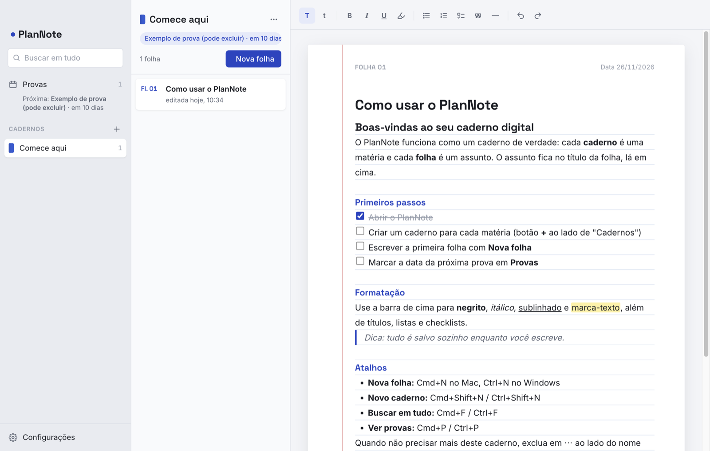
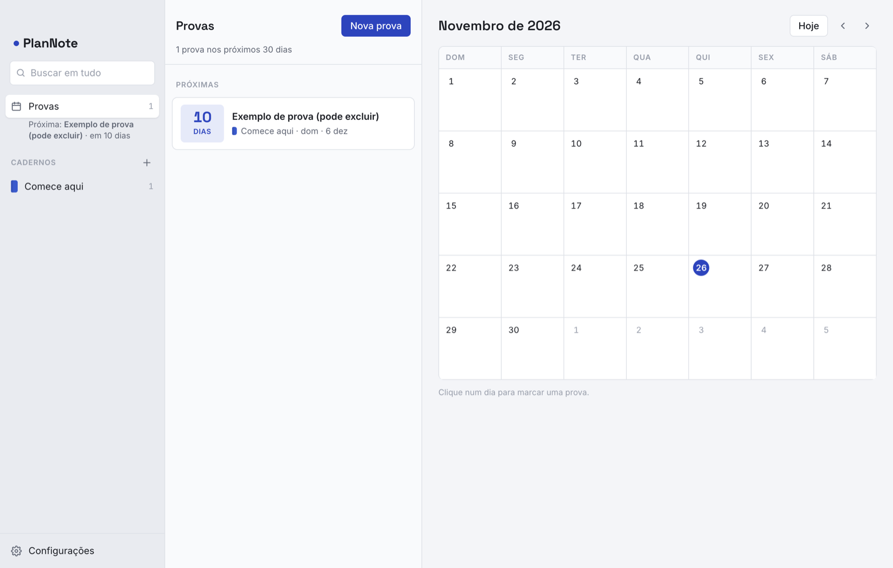

# PlanNote

Caderno digital para Mac e Windows. Organize suas anotações em cadernos e folhas e acompanhe as datas das provas.

Sem conta, sem servidor e sem assinatura: seus cadernos ficam no seu computador, como arquivos comuns.



## O que dá para fazer

- **Cadernos e folhas.** Um caderno para cada matéria. Dentro dele, cada folha é um assunto, e o assunto é o título da folha.
- **Editor de texto:** títulos, negrito, itálico, sublinhado, marca-texto, listas, checklists e citações.
- **Provas com contagem regressiva.** Marque a data de cada prova, ligue a um caderno e veja quantos dias faltam. Também tem um calendário do mês.
- **Busca em tudo.** Procura em todas as folhas de todos os cadernos e ignora acentos e maiúsculas.
- **Salvamento automático** enquanto você escreve.
- **Modo claro e escuro**, que segue o tema do sistema.



## Onde ficam os seus dados

Por padrão, na pasta **Documentos/PlanNote Cadernos**:

```
PlanNote Cadernos/
  cadernos/<id>/caderno.json
  cadernos/<id>/folhas/<id>.json
  provas.json
  .lixeira/          ← o que você exclui vem para cá
```

- **Backup:** copie essa pasta.
- **Usar em dois computadores:** em **Configurações → Trocar pasta…**, escolha uma pasta dentro do iCloud Drive, OneDrive ou Dropbox. Os dois computadores passam a ver os mesmos cadernos.
- **Nada é apagado de vez.** O que você exclui vai para a pasta `.lixeira`.

## Rodar a partir do código

É preciso ter o [Node.js](https://nodejs.org) 20 ou mais novo.

```bash
git clone <endereço deste repositório>
cd PlanNote
npm install
npm start
```

Outros comandos:

| Comando | O que faz |
|---|---|
| `npm run dev` | Abre o app recarregando a interface a cada alteração no código |
| `npm test` | Roda os testes automáticos |
| `npm run dist:mac` | Gera o instalador `.dmg` para Mac |
| `npm run dist:win` | Gera o instalador `.exe` para Windows |

## Estrutura do código

| Pasta | Conteúdo |
|---|---|
| `electron/` | Processo principal: janela, menus e leitura e gravação dos arquivos (`storage.cjs`) |
| `src/` | Interface: tela principal (`main.js`), editor (`editor.js`) e janelas de diálogo (`modal.js`) |
| `src/styles/` | Visual. Todas as cores ficam em `theme.css` |
| `src/lib/` | Funções de datas, busca e utilidades |
| `tests/` | Testes automáticos (`node --test`) |

Feito com [Electron](https://www.electronjs.org), [Vite](https://vite.dev) e [TipTap](https://tiptap.dev).

## Licença

[MIT](LICENSE). Pode usar, copiar, modificar e distribuir à vontade.
